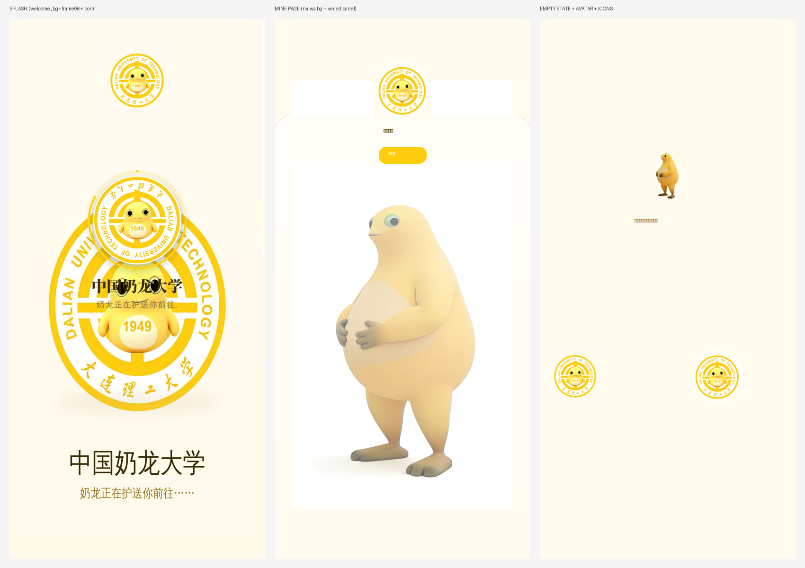

# 奶蛙 i大工 🐛 (NaiWa-iDUT)

> 把「i大工」（大连理工大学校园 App）做成**奶龙/奶蛙主题**的定制版
>
> 入场动画复刻自 [中国奶龙大学.com](https://xn--fiqs8srwb9iv6f6w9n.com/)（奶龙正在护送你前往中国奶龙大学）

## 成品下载

| 文件 | 说明 |
|---|---|
| `i大工_奶蛙版_3.3.12.apk` | **v5.1 奶蛙主题定制版（最新）**（本仓库直接下载，或到 [Releases](../../releases) 下载 ASCII 文件名版本） |
| `i大工_3.3.12.75026.apk` | 原版 App（未修改） |

**版本**：基于 i大工 3.3.12.75026 · 签名密钥为本项目自签（需卸载旧版/官方版后安装）

> ⚠️ **请务必下载最新版 v5.1**（v1/v2 已删除）。历版修复迷：v1 开屏白屏 → v3 三层保险 → v4 比例修复+全面奶蛙化图标 → v5 开屏动画根治+「关于i大工奶蛙」页 → **v5.1 修复关于页仓库链接**（账号为 43aquarius）。

## v3.0 改了什么（相对 v2）

用户实测反馈三个问题（开屏无动画 / 背景不见 / 蓝色残留），v3 全部处理：

| 反馈 | v3 修复 |
|---|---|
| 开屏还是白屏没有奶蛙 | ① 冷启动窗口背景本身就带**奶蛙吉祥物 + 「中国奶龙大学」标题**（welcome_bg_pic 9-patch 重绘）——即使动画代码全部失效，打开 App 第一眼也是奶蛙；② 修复 v3 构建中 `if-eqz` 分支未删净的回归（构建后逐字节校验最终 dex）；③ 欢迎页布局 `idIdx` 与原版 aapt 输出完全一致；④ 12 帧动画 + AnimStarter post 启动 + XML 静态首帧兜底，三层保险 |
| 主背景没生效 | 首页是 **H5 WebView 全屏覆盖**，原生背景被挡住（v2 已埋好但看不见）。v3 按用户要求把**「我的」页面背景彻底换成 naiwa**：根布局背景 + 内容面板 9-patch 都是奶蛙图（面板加白纱保证文字可读、保留圆角），纯原生页面 100% 可见 |
| 想要更多奶蛙 | 从 naiwa 游戏网站（奶蛙消消乐/合成大奶娃）抓取素材：**默认头像 5 款全部换成奶蛙头**（custom_head_bg_default/boy/girl/org/parent + app_def），**10 张空状态占位图**换成奶蛙吉祥物（消息/通知/收藏/通讯录空列表等） |
| 蓝色残留 | 值 127 处 + **321 张图片像素级重着色**（约 555 万像素），蓝/青/绿全部 HSL 色相平移到奶龙黄，保留明度与透明度 |

## v3 界面预览



## 功能总览（v1→v3 累计）

### 1. 启动动画（复刻中国奶龙大学网站的入场动画）
- 冷启动窗口：奶龙米色渐变背景 + **奶蛙吉祥物立绘 +「中国奶龙大学」标题 +「奶龙正在护送你前往……」副标题**（静态兜底层）
- 欢迎页 12 帧帧动画：白底圆盘徽章 + 旋转文字环（网站的 ring.webp）+ 中心奶龙呼吸缩放（core.webp）+ 奶龙黄进度环
- `WelcomeActivity.n()` smali 补丁：nop 跳过「无服务器缓存图则跳过欢迎页」分支（**v1 白屏根因**）+ AnimStarter post 启动 + try-catch 兜底 + 时长 2.6s

### 2. 背景与图标
- **「我的」页面（v3 重点）**：根背景 `main_page_bg`（naiwa 9-patch）+ 内容面板 `bg_mine_panel.9.png`（naiwa + 白纱渐变 + 圆角，aapt2 编译）
- 主页/服务页背景同源 naiwa 9-patch（原生层；H5 层不受本地控制）
- App 图标全套 ← `naiwa (2).jpeg`（自适应图标 foreground/background + 全密度）
- 默认头像 5 款 + `app_def` ← 奶蛙头
- 空状态占位图 10 张 ← 奶蛙吉祥物（naiwa 消消乐素材）
- 首次启动引导页 4 张奶蛙风格重绘

### 3. 配色（大工蓝 → 奶龙黄）
主色 **奶龙黄 `#FECE0E`**，奶油底 `#FFFBEF`、深棕字 `#3A2C00`。
- 颜色值 127 处（arsc + 二进制 XML，蓝/青 hue 175-275 且 s>0.12；蓝灰→暖棕）
- **321 张 PNG/WebP 像素级色相平移**（npTc/npOl 块完整保留）
- 服务器下发的 H5 页面颜色无法本地修改

## 目录结构

```
├── i大工_奶蛙版_3.3.12.apk     # 成品 (v5.1)
├── i大工_3.3.12.75026.apk      # 原版
├── naiwa.png / naiwa (2).jpeg  # 素材原图
├── theme/                      # 生成的主题资源（帧动画/图标/9-patch/引导页/抠图）
├── patches/                    # 全部构建脚本（Python + Bash）
│   ├── build_v3.sh             # 一键流水线（v3，含最终 dex 校验）
│   ├── gen_assets_v3.py        # 素材生成（9-patch/头像/空状态）
│   ├── gen_welcome_layout_v3.py# 二进制 AXML 生成器（idIdx 对齐原版）
│   ├── patch_layouts_v3.py     # activity_main/tab_service/tab_mine 背景补丁
│   ├── patch_smali_v3.py       # smali 补丁（nop 分支 + AnimStarter + 2.6s）
│   ├── recolor_v3.py           # 颜色值宽网替换（arsc + XML）
│   ├── recolor_images_v3.py    # 像素级图片重着色（npTc 保留）
│   ├── assemble_v3.py          # APK 组装（按原压缩方式）
│   └── arsc_parser.py          # ARSC/AXML 二进制解析库
├── preview/                    # 预览图（preview_sheet_v3.png）
└── .github/workflows/          # 打 tag 自动发布 release
```

## 构建流水线（可复现）

```bash
# 依赖: JDK 17+, aapt2+zipalign+apksigner (Android build-tools 34, 放 /home/z/tools/android-14),
#       smali/baksmali 2.5.2 及依赖 (放 /home/z/tools/smali_lib), Python3 + PIL + numpy
bash patches/build_v3.sh
```

流水线自动执行：解包 → baksmali → 素材生成（aapt2 编译 9-patch）→ welcome_layout 重写 → 布局补丁 → smali 补丁 → 双重重着色 → smali 重组 → 组装 → 对齐 → 签名 → **最终 APK 内 dex 逐项校验**。

## 安装说明

1. 下载 `i大工_奶蛙版_3.3.12.apk`（或 Release 里的 `iDaGong_NaiWa_v5.1.apk`）
2. **先卸载**官方 i大工与旧奶蛙版（自签证书，无法覆盖安装；卸载会清除本地登录数据）
3. 允许"安装未知来源应用"后安装
4. 打开 App：冷启动即见奶蛙吉祥物 → 欢迎页 2.6s 动画 → 进入 App，切到「我的」看奶蛙背景页 🐛

## 技术笔记

- 分析工具：[REA (Reverse Engineer Anything)](https://github.com/morluto/rea) + 自研 ARSC/AXML 二进制解析器（`patches/arsc_parser.py`），用于定位启动 Activity（`com.ruijie.whistle.module.welcome.view.WelcomeActivity`）、主题（`WelcomeActivityTheme` → windowBackground = `welcome_bg_pic`）与主色（`idg_theme_color`）
- **v1 白屏根因**：`WelcomeActivity.n()` 中 `setContentView(welcome_layout)` 只在服务器背景图已缓存时执行，首次安装直接走 `m()` 跳转 → 白屏一段再进主页。修复 = nop 掉该分支
- **v2 背景不可见根因**：主页内容是 H5 WebView 全屏覆盖，原生背景被完全遮挡 → v3 把 naiwa 背景落在纯原生的「我的」页
- 该 App 为微哨（Ruijie Weishao）平台应用，多数业务界面是 H5（服务端下发）：原生层能改的均已奶蛙化；**H5 页面颜色不受本地资源控制**
- npTc 9-patch 逆向：编译后 9-patch 的 npTc/npOl 块在像素重着色/替换时提取重插，保证拉伸行为
- 签名为项目自签，官方热更/签名校验可能失效

## 声明

本项目仅供学习交流与个人娱乐（奶龙太可爱了）。与大连理工大学、微哨/锐捷无任何关联；奶龙形象版权归其权利人所有；请理性玩梗，快乐护送。
